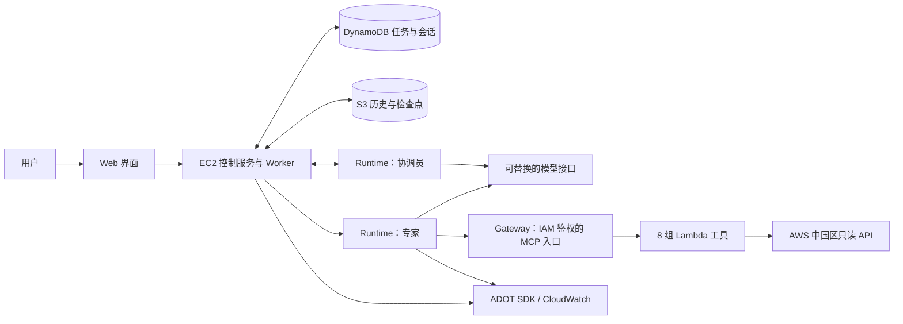

# CloudOps：在 AWS 中国区构建多 Agent 运维助手

这是一个中文参考项目：用户提出运维问题，协调员分配工作，专家调用只读 AWS 工具，最后给出带证据的结果。

它使用 **AgentCore Runtime 托管 Agent、Gateway 接入 MCP 工具、Strands 调用模型，以及应用自己的 harness 管理任务**。代码来自实际 CloudOps 应用的独立整理版，去除了开发工作区和私有部署信息。

适合想回答三个问题的读者：Agent 怎么部署？多个 Agent 怎么可靠协作？中国区缺少部分托管能力时怎么实现？

## 先看整体



**AgentCore 不等于模型。** Runtime 运行你的代码；模型请求由代码发送。本项目通过 OpenAI 兼容协议连接你批准的 HTTPS 模型服务，密钥放在 Secrets Manager。更换模型时需要重新验证工具调用、覆盖完整性和回答质量。

## 可以做什么

| Agent | 工作 |
| --- | --- |
| CloudOps 协调员 | 识别任务、选择专家、安排依赖、汇总结果 |
| Monitoring | 实例发现、CloudWatch 指标查询 |
| CloudTrail | 审计事件查询、分页与定向筛选 |
| FinOps | 费用、预测、价格查询 |
| AgentCore | 平台 Runtime、Gateway 等配置查询 |
| Terraform | 基础设施文档和方案建议；执行功能默认关闭 |

Web 提供专家入口、团队管理、历史会话、任务进度、观测指标和调用链。首次部署不自动创建定时任务，不启用 Terraform plan/apply。没有 Codex、浏览器或代码沙箱模块。

## 从这里开始

1. [架构与中国区功能](docs/01-architecture.md)：理解组件、身份方向和服务差异。
2. [准备环境](docs/02-prerequisites.md)：账号、模型、Linux 与权限。
3. [逐步构建 CloudOps](docs/03-deployment.md)：每一步创建什么、怎么确认。
4. [第一个 Runtime 与调用方法](docs/04-runtime.md)：从本地 HTTP 到云上 SDK。
5. [Gateway 与只读工具](docs/05-gateway.md)：工具协议和三层 IAM 权限。
6. [多 Agent 和 harness](docs/06-harness.md)：分工、恢复、交叉检查。
7. [观测与排障](docs/07-observability.md)：任务记录与 Trace 的关系。
8. [更新、费用和清理](docs/08-operations.md)：日常维护与成本边界。
9. [安全边界](docs/09-security.md) · [质量评估](docs/10-evaluation.md) · [验证记录](docs/11-validation.md)。

完整导航见 [docs/README.md](docs/README.md)，接手代码见 [handoff.md](handoff.md)。

## 先在本地检查代码

```bash
python3.12 -m venv .venv
source .venv/bin/activate
pip install -r requirements-dev.txt
python -m pytest tests -q
python scripts/check_public.py --tree
cd frontend
npm ci
npm run build
```

这些命令不创建云资源。完整应用依赖云端 Runtime 和 Gateway，不能仅凭前端开发服务器完成真实查询。

## 版本与验证边界

本参考部署针对宁夏区 `cn-northwest-1`，Runtime 平台 **V2**；平台 V2 与应用配置版本 1、2、3 是两回事。中国区功能以[官方差异说明](https://docs.amazonaws.cn/en_us/aws/latest/userguide/bedrock-agentcore.html)为准，文档核对日期为 2026-10-14。

独立版通过了 Python 测试、前端构建和 SDK 请求参数检查。核心流程来自已在宁夏部署的应用；**本仓库新增的完整账号初始化与权限组合尚未重新部署到一个全新云环境**，详见[验证记录](docs/11-validation.md)。这是可审阅的参考实现，使用前应在测试账号完成端到端验收。

项目为个人参考实现，并非 AWS 官方产品。来源与许可证见 [NOTICE](NOTICE.md)。
