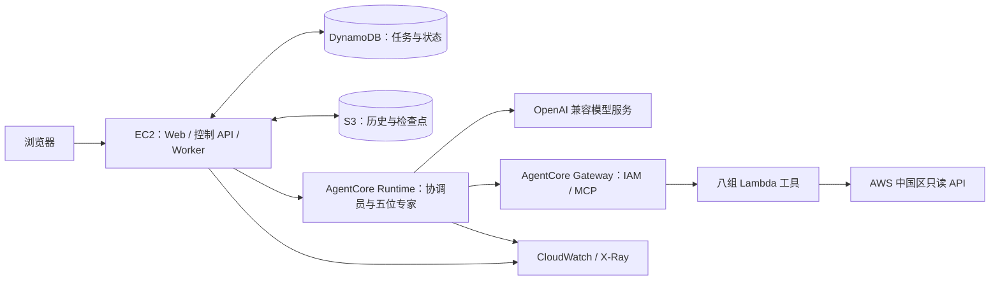

# CloudOps：AWS 中国区多 Agent 运维助手

基于 Amazon Bedrock AgentCore 和 Strands Agents 的云运维参考实现。协调员根据用户请求分派专家，通过只读 MCP 工具查询 AWS 资源、指标、审计事件和费用，汇总带工具证据的结果。

## 架构



| Agent | 查询范围 |
| --- | --- |
| 协调员 | 能力选择、任务依赖、专家分派和结果汇总 |
| Monitoring | 资源发现、CloudWatch 指标与告警 |
| CloudTrail | 管理操作审计、分页与事件筛选 |
| FinOps | Cost Explorer 费用、预测与公开价格 |
| AgentCore | Runtime、Gateway 等平台配置 |
| Terraform | Provider 文档与基础设施方案 |

默认部署：宁夏区 `cn-northwest-1`、六个 Runtime、一个 Gateway、八组 Lambda Target、四个 EC2 容器。Terraform plan/apply 和定时任务自动执行默认关闭。模型通过 OpenAI 兼容 HTTPS 接口调用，密钥存放在 Secrets Manager。

## 部署、测试与清理

| 步骤 | 文档 | 完成标准 |
| --- | --- | --- |
| 1 | [架构与中国区功能替代](docs/01-architecture.md) | 理解组件、权限和应用实现范围 |
| 2 | [环境准备](docs/02-prerequisites.md) | Linux、AWS 身份、Docker 和模型端点可用 |
| 3 | [部署](docs/03-deployment.md) | Runtime / Target READY，Web 可以登录 |
| 4 | [测试与验收](docs/10-testing.md) | 单专家、协作、持久化与只读边界通过 |
| 5 | [清理资源](docs/11-cleanup.md) | 按依赖删除项目资源并检查残留 |

部署入口：

```bash
git clone https://github.com/zjinsong/CloudOps-AgentCore-China.git
cd CloudOps-AgentCore-China
python3.12 -m venv .venv
source .venv/bin/activate
pip install -r requirements-dev.txt
python scripts/init_config.py
```

随后按[部署指南](docs/03-deployment.md)创建模型 Secret 和 ECR 仓库，填写私有配置，再依次执行 `foundation`、`gateway`、`runtimes` 阶段。脚本不创建 EC2；完整部署需要云端资源和可访问的模型服务。

## 中国区功能替代

本项目使用 Runtime、Gateway 和 Observability。对中国区不提供的托管 Memory、Harness、Registry、Policy 和 Evaluations，分别使用 DynamoDB/S3、应用任务调度、能力清单、IAM/代码校验及本地测试和云端验收；替代范围见[架构说明](docs/01-architecture.md)。服务支持范围以 [AWS 中国区官方说明](https://docs.amazonaws.cn/en_us/aws/latest/userguide/bedrock-agentcore.html)为准。

## 使用范围

本项目提供应用账号登录和用户记录隔离；企业 SSO、租户级 AWS 权限隔离、自动答案语义评分和 Terraform 执行角色不包含在默认部署中。完整部署是否可用，应按测试指南在目标账号验收；本地测试不替代云端验证。

[技术文档](docs/README.md) · [贡献指南](CONTRIBUTING.md) · [安全报告](SECURITY.md) · [来源与许可](NOTICE.md)
