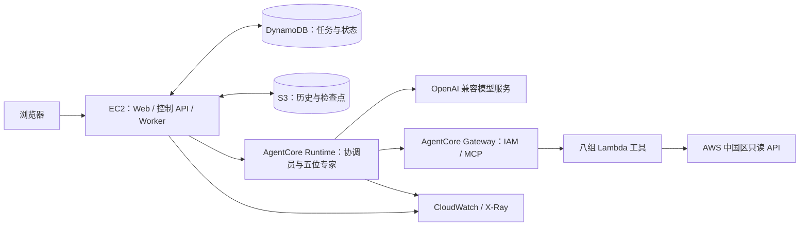

# CloudOps：AWS 中国区多 Agent 运维助手

基于 Amazon Bedrock AgentCore 和 Strands Agents 的云运维参考实现。协调员根据用户请求分派专家，通过只读 MCP 工具查询 AWS 资源、指标、审计事件和费用，汇总带工具证据的结果。

## 架构

| Agent | 查询范围 |
| --- | --- |
| 协调员 | 能力选择、任务依赖、专家分派和结果汇总 |
| Monitoring | 资源发现、CloudWatch 指标与告警 |
| CloudTrail | 管理操作审计、分页与事件筛选 |
| FinOps | Cost Explorer 费用、预测与公开价格 |
| AgentCore | Runtime、Gateway 等平台配置 |
| Terraform | Provider 文档与基础设施方案 |

默认部署：宁夏区 `cn-northwest-1`、六个 Runtime、一个 Gateway、八组 Lambda Target、四个 EC2 容器。Terraform plan/apply 默认关闭，预置定时任务默认停用；用户可在页面创建并启用定时任务。模型通过 OpenAI 兼容 HTTPS 接口调用，密钥存放在 Secrets Manager。

## 中国区功能替代

本项目使用 Runtime、Gateway 和 Observability。对中国区不提供的托管 Memory、Harness、Registry、Policy 和 Evaluations，分别使用 DynamoDB/S3、应用任务调度、能力清单、IAM/代码校验及本地测试和云端验收；替代范围见[架构说明](docs/01-architecture.md)。服务支持范围以 [AWS 中国区官方说明](https://docs.amazonaws.cn/en_us/aws/latest/userguide/bedrock-agentcore.html)为准。

## 部署

使用宁夏区测试账号和一台 Ubuntu 24.04 x86_64 EC2。需要 Python 3.12、Docker / Compose / Buildx、AWS CLI，以及支持工具调用的 OpenAI 兼容模型端点。

1. 按[环境准备](docs/02-prerequisites.md)检查工具、AWS 身份及 x86 → ARM64 构建环境。
2. 按[部署指南](docs/03-deployment.md)完成下列阶段；该文档提供完整命令与每步验证结果。

| 阶段 | 结果 |
| --- | --- |
| 初始化、ECR 与模型 Secret | 私有配置、镜像仓库和模型凭证 |
| foundation | DynamoDB、S3、Runtime / EC2 角色 |
| Layer 打包与 ARM64 镜像构建 | 工具依赖包、已推送 ECR 的 Runtime 镜像 |
| gateway / runtimes | 八组 MCP Target、六个 Runtime READY |
| 任务遥测与 Web 启动 | Trace 接收配置、可登录的页面 |

脚本不创建 EC2。部署完成后，通过 SSH 隧道访问 `http://localhost:3100`，使用生成的 admin 密码登录。

## 页面功能

Web 提供 CloudOps 工作区和观测指标两个入口，包含以下功能：

| 页面 / 功能 | 内容 |
| --- | --- |
| 专家对话与协作 | 单独向专家提问，或由协调员选择专家；支持显式指定专家、并行分工和上游结果传递 |
| 团队管理 | 查看专家职责、启用状态和任务能力可用性；启用或停用专家 |
| 会话历史与任务进度 | 保存对话、任务状态和专家结果；刷新后继续查看，支持从任务或回答进入调用链 |
| 定时任务 | 创建、编辑、启停和删除任务，配置执行时间、时区及重复周期，查看运行记录与结果；预置任务默认停用 |
| 观测指标 → 服务指标 | 查看各 Agent Runtime 和共享 Gateway 的调用、错误、延迟等指标；支持时间范围筛选、手动刷新和每分钟自动刷新 |
| 观测指标 → 任务调用链 | 按时间、状态和专家筛选任务，分页查看详情；展示 Task ID、Trace ID、总耗时、执行尝试次数及阶段 / Span 时间线 |

### 服务指标与 Trace / Span

- **服务指标**：Runtime 展示调用次数、错误、延迟、运行或连接时长，以及 CPU（vCPUh）和内存（GBh）用量；Gateway 展示调用、错误、限流、延迟和 Target 执行时间。协调员使用 WebSocket，其连接指标与专家 HTTP 请求指标分别展示。
- **Trace**：通过 Trace ID 关联同一业务任务的调用过程，结合任务记录定位规划、分派、专家执行和汇总阶段。
- **Span**：表示专家、模型或 MCP 调用的执行片段，记录父子关联、时间和错误状态；页面以时间线展示并行与串行调用，区分任务阶段记录和 SDK Span。

部署后可查看 Runtime 和 Gateway 服务指标。完成部署指南中的[任务遥测配置](docs/03-deployment.md#8-配置任务遥测)后，还可查看模型和工具调用的耗时与错误。CPU、内存展示所选时间段的累计资源用量。

参考：[观测与排障](docs/07-observability.md) · [多 Agent 调度](docs/06-harness.md) · [测试与验收](docs/10-testing.md)。

## 测试与清理

| 文档 | 操作 |
| --- | --- |
| [测试与验收](docs/10-testing.md) | 检查服务，验证专家查询、团队管理、定时任务、服务指标与任务调用链 |
| [清理资源](docs/11-cleanup.md) | 停止任务，按依赖删除云资源、日志和本地构建器 |
| [更新与运维](docs/08-operations.md) | 发布新版本、回退和费用管理 |

应用身份与数据权限范围见[安全边界](docs/09-security.md)。

[技术文档](docs/README.md) · [贡献指南](CONTRIBUTING.md) · [安全报告](SECURITY.md) · [来源与许可](NOTICE.md)
