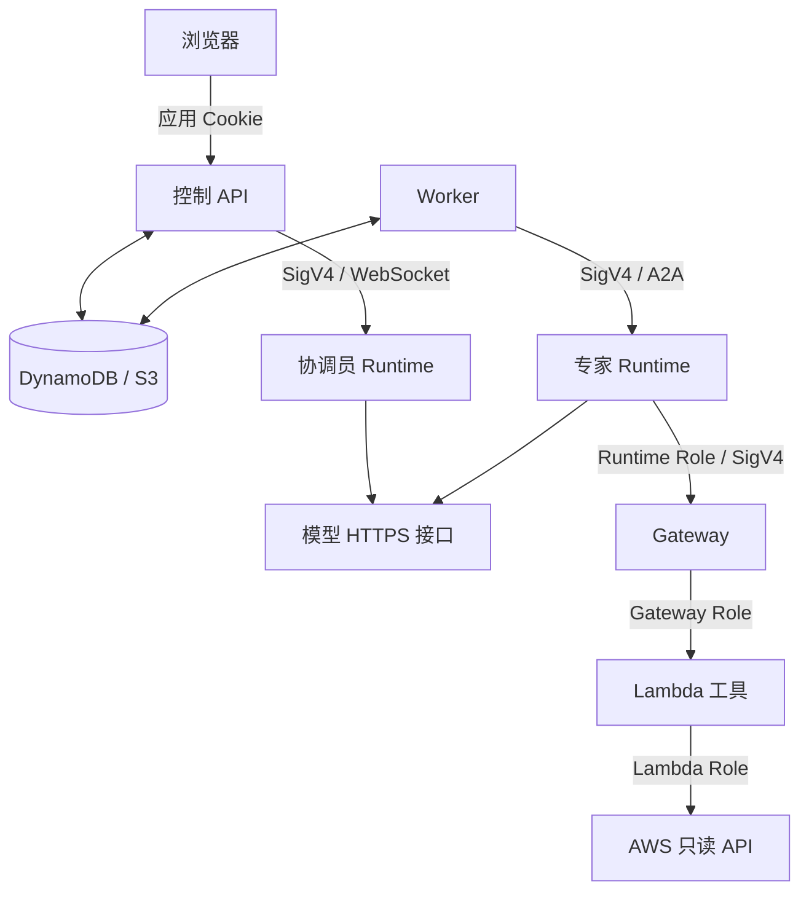

# 架构与中国区功能替代

## 组件

| 组件 | 职责 | 实现 |
| --- | --- | --- |
| Web / 控制 API | 登录、会话、任务、结果和观测入口 | EC2 Docker Compose，React + FastAPI |
| Worker | 计划校验、依赖调度、租约续约和失败恢复 | `control/` |
| AgentCore Runtime | 托管协调员和五位专家 | ARM64 容器；协调员 WebSocket，专家 A2A |
| Strands Agents | 模型调用与工具执行 | `framework/model.py`、`agents/` |
| AgentCore Gateway | MCP 工具枚举与调用入口 | `AWS_IAM`，八组 Lambda Target |
| DynamoDB | 任务、版本、租约、配置和历史索引 | 四个 GSI、TTL、时间点恢复 |
| S3 | 对话正文、结果、附件和会话检查点 | 两个私有桶，历史默认 30 天 |
| CloudWatch / X-Ray | 服务指标、日志和任务 Span | ADOT SDK，无独立 Collector |
| Secrets Manager | 模型 API Key | Runtime Role 和 Web Role 按 ARN 读取 |

## 任务执行

1. 控制 API 校验用户并持久化任务。
2. 协调员根据已启用专家、能力定义和 Gateway 工具清单生成最多六步的 DAG。
3. 程序校验能力、区域和依赖；Worker 并行执行独立步骤，依赖步骤等待上游结果。
4. 专家调用工具，保存结果及执行状态；上游失败时依赖分支不执行。
5. 协调员汇总证据，区分真实数据、空数据、工具错误和未覆盖范围。

DynamoDB 是任务状态来源；当前调度使用 `active-index`，不部署 SQS。Worker 使用执行租约和 S3 检查点恢复任务；页面连接与 Runtime 会话寿命不决定业务记录保留期。

## 权限与模型

浏览器使用应用账号登录。控制服务通过 EC2 Role 调用 Runtime，专家通过 Runtime Role 调用 Gateway，Gateway Role 只调用项目 Lambda，Lambda Role 限制业务读取动作。用户记录隔离不等同于租户级 AWS 权限隔离。

模型运行在 AgentCore Runtime 之外，通过 `MODEL_ID`、`MODEL_BASE_URL` 和 Secrets Manager 中的 `api_key` 调用。当前适配器使用 OpenAI 兼容协议；Bedrock 原生 API 需要单独的模型适配器。模型端点必须支持工具调用，并可从 Runtime 网络访问。

## 中国区差异与替代范围

以下依据 [AWS 中国区功能说明](https://docs.amazonaws.cn/en_us/aws/latest/userguide/bedrock-agentcore.html)核对（2026-10-18）。部署脚本限定宁夏区；服务在其他区域的可用性不代表脚本可直接迁移。

| 中国区差异 | 本项目实现 | 范围 |
| --- | --- | --- |
| Memory 不提供 | DynamoDB 会话索引、S3 历史与检查点 | 持久化上下文，不含语义长期记忆 |
| Harness 不提供 | Worker、依赖调度、租约、预算和恢复 | CloudOps 应用执行控制 |
| Registry 不提供 | `hierarchy.json`、应用注册记录和能力映射 | 本应用专家与工具清单 |
| Policy 和 Gateway rules 不提供 | IAM、工具/API 白名单、计划及参数校验 | 无托管策略引擎 |
| Evaluations 不提供 | 本地测试、固定云端用例和人工证据核对 | 无自动语义评分服务 |
| Gateway 工具语义搜索不提供 | `tools/list`、能力映射、专家工具白名单 | 显式工具发现 |
| Runtime/Gateway 不支持 Cognito 入站 | Runtime/Gateway 使用 IAM；Web 使用应用登录 | 企业 OIDC 需另行集成 |
| Gateway 推理目标不提供 | Agent 直接调用模型 HTTPS 端点 | 模型流量不经 Gateway |
| Runtime 仅支持 MicroVM；不支持 S3 Files 挂载 | 按需运行容器，通过 S3 API 保存持久数据 | 不依赖本地持久文件系统 |

中国区 Identity 存在私有 IdP 和部分内置 OAuth Provider 限制；本项目不配置 OAuth/API Key Provider，也不依赖连接器目录。Knowledge Bases、Payments、Optimizations、Browser 和 Code Interpreter 不参与本项目默认架构。

[部署](03-deployment.md) · [协作实现](06-harness.md) · [权限](09-security.md)
