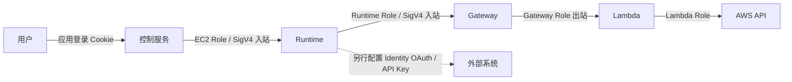

# 一、先理解架构

假设你问：“宁夏区运行中的 EC2 最近一小时 CPU 怎么样，昨天有人关机吗，费用值得关注吗？”

一个模型可以生成查询建议，但真正完成任务还需要：登录校验、工具权限、实例发现、分页、并行查询、超时处理和结果存储。这些是本项目的主要工作。

## 组件的分工

| 组件 | 负责 | 项目里的位置 |
| --- | --- | --- |
| Runtime | 托管容器、隔离会话、伸缩 | 协调员和五个专家分别部署 |
| Gateway | 把 Lambda 暴露成 MCP 工具，校验调用身份 | 八组工具共享一个入口 |
| Identity | 工作负载身份及外部系统的凭证集成 | 本例没有创建 OAuth/API Key Provider |
| Observability | 接收运行指标与遥测 | CloudWatch 指标、SDK Span |
| Strands | 调用模型并执行模型选中的工具 | `framework/model.py` 和专家入口 |
| 应用 harness | 约束、调度、恢复和验收任务 | `control/`、`framework/validator.py` |
| DynamoDB / S3 | 持久任务状态、历史与检查点 | 控制服务和专家共享 |

模型在 Runtime 外提供推理服务。Agent 使用 `MODEL_ID`、`MODEL_BASE_URL` 和 Secrets Manager 中的密钥调用它。当前适配器实现 OpenAI 兼容协议；接 Bedrock 原生 API 需增加相应模型适配器，不能只换 URL。

## 入站、出站别混在一起

**入站**回答“谁可以调用我”：本例 Runtime 和 Gateway 使用 IAM/SigV4；浏览器用户先登录应用，应用代为签名调用。企业方案可以改用 OIDC IdP 的 JWT，由 Runtime/Gateway 验证；登录页面仍由应用或 IdP 提供。

**出站**回答“Agent 凭什么访问下游”：AWS 资源使用执行 Role；外部 SaaS 可用 Identity 管理 OAuth token 或 API Key，再由外部系统判断权限。用户登录过，不代表 Agent 自动获得全部外部权限。Role 也不会自动转换成任意 SaaS 的账户权限。

本项目没有调用 Identity 的凭证获取接口，因此不是 OAuth/API Key 出站示例。Runtime 自动工作负载身份和外部凭证 Provider 是不同层次。

## 中国区怎么办

中国区可用 Runtime、Gateway、Identity、Observability，以及本项目未使用的 Browser、Code Interpreter。部分 Global 托管能力不在中国区提供。

| 中国区差异 | 本项目的做法 |
| --- | --- |
| 托管 Memory 不可用 | DynamoDB 会话记录、S3 历史；不是语义长期记忆 |
| 托管 Harness、Registry、Policy、Evaluations 不可用 | 应用调度、能力清单、代码校验、IAM 与离线评估 |
| Gateway 工具语义搜索不可用 | 工具枚举、能力映射和专家工具白名单 |
| Cognito 入站选项不可用 | 本例 IAM；企业登录可评估其他 OIDC IdP |
| 部分内置 OAuth Provider 与私有 IdP 配置不可用 | 按中国区支持范围评估自定义集成，不能照搬 Global 快速配置 |
| Gateway 推理目标和部分连接器不可用 | 模型从 Agent 直接调用；工具由 Lambda 接入 |

其他差异及最新支持范围见[官方中国区说明](https://docs.amazonaws.cn/en_us/aws/latest/userguide/bedrock-agentcore.html)。应用实现只解决自己的需求，不宣称复制了托管服务的全部能力。

## 与 AWS 示例的关系

参考 [AWS CloudOps 多 Agent 示例](https://github.com/aws-samples/sample-cloudops-multi-agent-system)的专业分工思路，本项目把 Agent 放进 Runtime，并增加持久任务、租约、能力验证和调用链。A2A 用于专家调用协议，MCP 用于工具协议；二者都不能代替任务调度和结果验收。

[下一章：准备环境](02-prerequisites.md)
