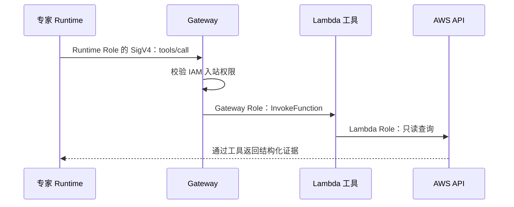

# 五、Gateway 怎么把工具接进来

假设 Monitoring 需要列出 Lambda 函数。给模型一句“你可以查看 AWS”不够，需要真正的工具、参数定义和 AWS 权限。

## 三层权限

Runtime Role 允许调用 Gateway；Gateway Role 允许调用指定 Lambda；Lambda Role 决定能查询哪些 AWS API。这三项不能互相代替。Gateway 用 IAM 入站不代表工具自动拥有管理员权限。

## 八组 Target

| Target | 工具来源 | 用途 |
| --- | --- | --- |
| cost-explorer | 自写 Lambda | 费用与预测 |
| cloudwatch | 自写 Lambda | 指标和指标发现 |
| pricing | AWS Pricing MCP | 价格查询 |
| cloudtrail-mcp | AWS CloudTrail MCP | 审计筛选与分页 |
| terraform-mcp | Terraform MCP | 文档和基础设施资料 |
| health-events | 自写 Lambda | 本项目归档的 Health 事件 |
| aws-api | AWS API MCP | EC2、Lambda 等详细只读查询 |
| agentcore-mcp | AgentCore MCP | 平台配置与资料查询 |

每组的 `tools.json` 是 Gateway 的参数契约；`handler.py` 或共享的 `mcp_lambda/handler.py` 负责执行。角色只读白名单在 [scripts/permissions.py](../scripts/permissions.py)，部分 MCP 工具还有独立代码白名单。不能只靠提示词要求“只读”。

官方工具参考：[AWS API MCP](https://awslabs.github.io/mcp/servers/aws-api-mcp-server)；Gateway 概念见[官方指南](https://docs.amazonaws.cn/en_us/bedrock-agentcore/latest/devguide/gateway.html)，中国区范围以[差异页](https://docs.amazonaws.cn/en_us/aws/latest/userguide/bedrock-agentcore.html)为准。

## 一个工具是怎么构建的

以 CloudWatch 为例：

1. 在 `tools/cloudwatch/tools.json` 定义工具名、描述和 JSON Schema。
2. Lambda `tools/cloudwatch/handler.py` 接收参数，用 boto3 查询，并返回数据。
3. 部署脚本创建 Lambda Role，只授予列指标、取指标等读取动作。
4. Gateway Target 指向 Lambda ARN，使用 `GATEWAY_IAM_ROLE` 访问。
5. Runtime 通过签名 MCP 客户端枚举工具；能力映射确认 Monitoring 获得所需工具。

Gateway 调 Lambda 时会在 `context.client_context.custom` 中传入工具名信息。共享 Handler 据此选择真正的 MCP 工具，不能只看参数猜测工具名，也不能直接绕过 Gateway 的命名契约。

## 查询完整性也是工具的责任

CloudTrail 结果存在分页标记时，不能声称已查完。工具提供分页与筛选，专家必须明确时间范围、区域、过滤条件和是否穷尽结果。对 `StopInstances` 等具体事件，应按 EventName 定向查询，减少服务后台事件的噪声。

Monitoring 应先用实例/函数枚举工具确定资源 ID，再查指标；不能从账户级平均值推断某个函数发生错误。工具响应可被截断，截断也应被标成覆盖不足。

新增工具先改 Schema、权限、Handler 和能力映射，再升级 Gateway；工具列表就绪后再开放给专家。细节见[贡献指南](../CONTRIBUTING.md)。
