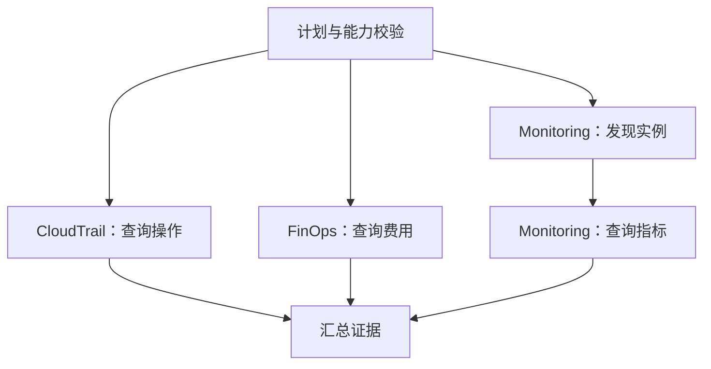

# 多 Agent 调度

应用执行控制层负责计划校验、持久任务、依赖调度、执行预算和恢复；Strands 负责 Agent 内部的模型与工具调用。

## 计划与能力

`hierarchy.json` 定义专家；`control/capabilities.py` 定义能力、输入输出、工具及区域。Gateway 实际工具枚举结果决定能力是否可用。协调员生成最多六步的 DAG，校验专家启用状态、工具可用性、步骤引用和依赖循环后执行。

独立步骤并行，依赖步骤等待上游结果。同一专家可承担多个不同能力，例如先发现实例，再查询实例指标。专家结果包含执行状态和工具证据，汇总时区分成功、空数据和错误。

## 执行状态

| 机制 | 实现 |
| --- | --- |
| 持久任务 | DynamoDB 保存状态、版本、依赖和执行记录 |
| 调度 | `active-index` 查询待执行任务；当前不部署 SQS |
| 租约 | Worker 领取和续约，默认租约 120 秒 |
| 检查点 | S3 保存执行上下文，DynamoDB 记录进展 |
| 预算 | 默认分段期限 1,800 秒、模型调用上限 20 次 |
| 失败处理 | 上游失败时阻止依赖分支；独立分支可继续 |
| 恢复 | 基于持久记录和检查点恢复；未保存的只读查询可能重试 |

实际限制见 `control/execution.py` 和 `control/worker.py`。租约到期不表示外部请求立刻停止；恢复流程使用执行 token 和结果检查避免重复提交。

## 扩展位置

| 模块 | 用途 |
| --- | --- |
| `agents/supervisor/coordinator.py` | 规划、分派和汇总 |
| `control/capabilities.py` | 能力定义及计划校验 |
| `control/worker.py` | 调度及专家调用 |
| `control/execution.py` | 租约、预算和检查点 |
| `framework/model.py` | 模型适配与密钥读取 |
| `framework/gateway.py` | 签名 MCP 客户端 |

默认不启用 Terraform plan/apply。启用执行功能需额外配置 plan/apply 独立角色、STS 信任、状态存储和人工审批；这些角色不由本部署流程创建。

[测试与验收](10-testing.md)
