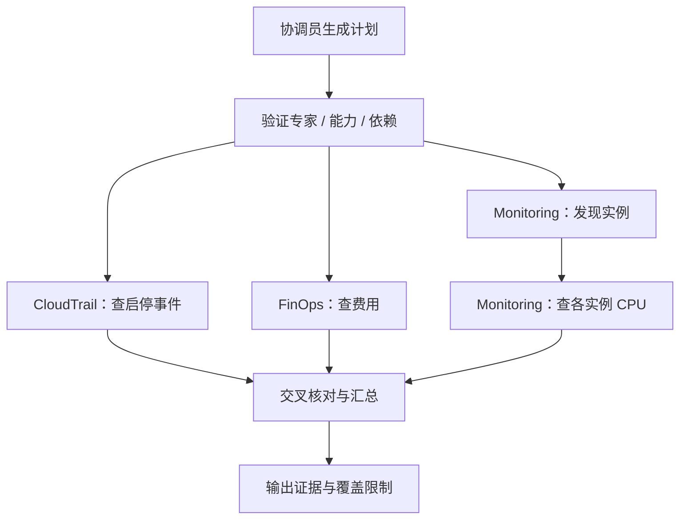

# 六、多 Agent 与 harness：让任务按规则完成

这里的 harness 是应用的执行控制层：模型给出计划，程序检查并调度，工具返回证据，程序保存状态，最后验收答案。它的目的不是保证模型永远正确，而是让错误可见、可恢复、可验证。

## 用一个具体任务观察

在协调员输入：

> 请让 Monitoring、CloudTrail 和 FinOps 协作检查宁夏区 EC2。先列出当前运行实例，再查询最近一小时 CPU 平均值和峰值、过去 24 小时 StartInstances/StopInstances，以及最近七天 EC2 费用。按实例 ID 与事件时间交叉核对，由协调员汇总运行状态、CPU、启停操作和费用关注点。账户级费用请明确标注，不能硬分摊到实例。仅只读查询，展示分工、进度和任务调用链。

一种合理的依赖图如下，实际计划由模型生成并经校验：

用户显式指定专家时，路由约束会保留指定对象；未指定时，协调员从能力清单选择。一个专家可以承担多个有依赖的步骤，不能人为限制为“一位专家只能一个步骤”。

## 能力清单怎么避免误选

`hierarchy.json` 定义角色与基础配置；`control/capabilities.py` 把业务能力映射到必要工具；Gateway 实际枚举结果决定能力是否可用。计划校验检查专家、能力、步骤引用和依赖循环。

工具不在清单、权限失败或查询无数据时，要记录失败原因，不能让模型以想象结果替代。能力清单不是中国区托管 Registry，也没有替代其全部功能。

## 任务不靠连接活着

| 机制 | 项目中的做法 | 解决什么 |
| --- | --- | --- |
| 持久任务 | DDB 保存 task、执行状态和版本 | 页面刷新后仍能查进度 |
| 租约 | Worker 领取任务、续约，过期可恢复 | Worker 中断不永久卡住 |
| 检查点 | S3 保存执行上下文，DDB 记录进展 | 长任务不必从头猜测 |
| 分段预算 | 默认段期限 1,800 秒、模型调用上限 20 次 | 控制无限循环和费用 |
| 依赖控制 | 上游失败时记录下游跳过，独立分支可继续 | 部分失败可解释 |
| 结果记录 | 每位专家结果与最终汇总分别保存 | 追溯结论来源 |

预算可配置，不应为了“稳定”直接无限放大。业务恢复也不是任意外部副作用的自动回滚；本例默认只读查询，不同时间重试可能得到不同数据，应记录查询时间。

持久化历史默认 30 天，执行租约通常为 120 秒并在执行期间续约。实际运行限制以 `control/execution.py` 和 `control/worker.py` 为准。租约过期不等于外部调用立刻停止，需配合执行 token、重复结果检查和副作用幂等设计。

## 为什么换模型也要评估

harness 能阻止部分非法计划、发现失败和保留证据，却不能证明模型理解了成本口径。新模型可能更快，却漏掉分页、混淆峰值与平均值，或者生成错误工具参数。

更换模型后，用同一组题、同一份离线工具数据比较结果，再做有限的云端只读验收。见[评估方案](10-evaluation.md)。

## 能不能解耦

可以先把计划、能力、状态机、执行与评估定义为稳定接口，再替换模型或 Agent 框架。本项目已经把模型适配、工具客户端和任务调度分到不同模块，但控制代码仍包含 CloudOps 业务逻辑；它不是现成的通用托管 harness。

不要为了抽象先拆出一个新服务。先让第二种 Agent 复用同一任务协议，明确共性，再决定是否独立部署。

## Terraform 是可选扩展

默认 `CLOUDOPS_ENABLE_TERRAFORM_PLAN=false`、`CLOUDOPS_ENABLE_APPLY=false`，executor 不启动。Terraform 专家仍可查询文档、提供建议。

启用真实 plan/apply 需要额外设计只读 plan Role、单独的 apply Role、STS 信任、状态存储范围和人工审批。仅打开布尔开关不够，也不能给 MCP 工具管理员权限。本快速部署不生成这些角色；执行器代码保留供审阅扩展，不能当成已完成的部署能力。
